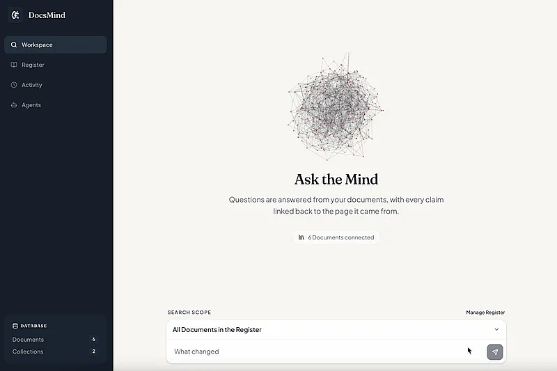
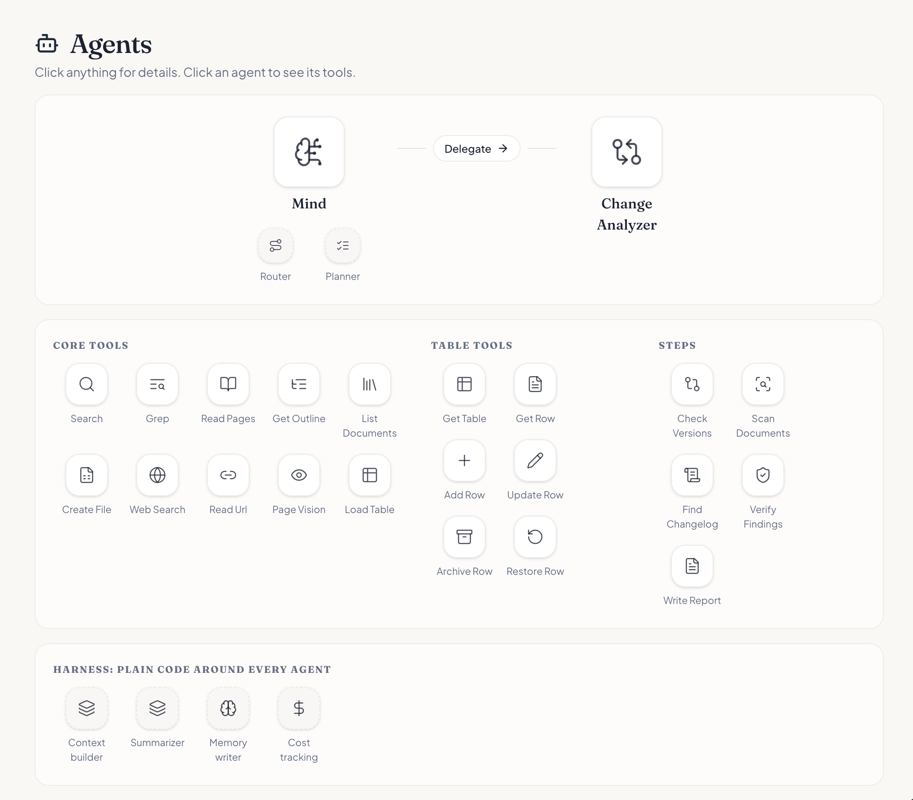
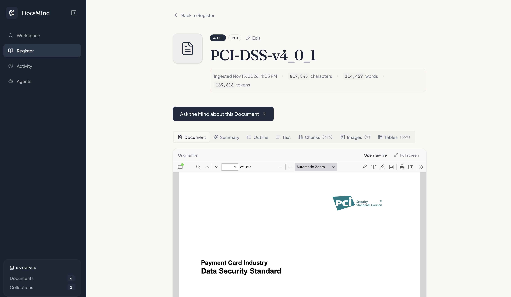

# docsmind

[](https://pypi.org/project/docsmind/) [](https://pypi.org/project/docsmind/) [](https://pepy.tech/project/docsmind) [](https://pepy.tech/project/docsmind) [](https://github.com/yauheniya-ai/docsmind/blob/main/LICENSE) [](https://github.com/astral-sh/ruff) [](#status)

> **An open research project** examining state-of-the-art agentic architectures for
> document analysis, targeted at complex technical documentation in fields that live by
> standards and regulation: energy, finance, life sciences, aerospace,
> automotive, telecommunication, and more.

<p align="center">
  
  <br />
  <em>The docsmind web interface: bundled with the PyPI package and started with <code>docsmind serve</code>.</em>
</p>

`docsmind` ingests PDFs into a version-aware Postgres/pgvector store and gives you an AI
document analyst, **the Mind**, which searches and reads them, answers with verified
page-level citations, and delegates specialized work to subagents. A bundled web UI
(`docsmind serve`), a CLI and a Python API sit on top.

One subagent is the **Change Analyzer**: it compares two versions of a standard or policy and
proves every compliance-relevant change with verbatim quotes and links to the exact pages of
both documents, then reports the result with full methodology and cost tracking.
See [Change analysis](#change-analysis).

## Install

```bash
pip install docsmind
```

One install covers everything: the OpenAI and Anthropic SDKs and the FastAPI server for the bundled
UI. OpenAI is the default provider for chat, embeddings and image captions, so a single
`DOCSMIND_OPENAI_API_KEY` is enough. Requires Python 3.10+ and a Postgres with pgvector
(see the quickstart).

## Quickstart

### 1. Get a Postgres with pgvector

Pick one:

**A. Local Docker (recommended for trying it out)**

```bash
docsmind db up         # docker compose up -d, pgvector/pgvector image on port 5434
docsmind db upgrade    # applies migrations, creates the vector extension
```

**B. Neon or Supabase** (no Docker needed; both support pgvector)

```bash
# in .env:
# DOCSMIND_DATABASE_URL=postgresql+asyncpg://<user>:<password>@<host>/<db>
docsmind db upgrade
```

Extracted images, table snippets and the original file are saved to local disk
(`DOCSMIND_BLOB_ROOT`). S3 and Supabase Storage backends are planned; the settings exist but
are not wired up yet.

Then check that everything is wired correctly:

```bash
docsmind doctor
```

Configuration is environment-driven (`DOCSMIND_*`, or a `.env` file). Copy
`.env.example` to `.env` to see every option. The defaults use OpenAI only
(`DOCSMIND_OPENAI_API_KEY`); to use Claude instead, set `DOCSMIND_LLM_PROVIDER=anthropic`,
`DOCSMIND_LLM_MODEL` and `DOCSMIND_ANTHROPIC_API_KEY` (same for `DOCSMIND_VISION_PROVIDER`).
Embeddings are OpenAI only. Ingestion and browsing need no key. Behind a company gateway, also set `DOCSMIND_OPENAI_BASE_URL`
and/or `DOCSMIND_ANTHROPIC_BASE_URL`; `docsmind doctor` shows which endpoint is used.

### 2. Ingest a PDF

Only PDF is supported today. Word, Excel, PowerPoint, text, images, audio and video are
planned (see [Status](#status)).

```bash
docsmind ingest report.pdf --collection policies
docsmind ingest report_v2.pdf --collection policies --version 2025   # version label is optional
```

or from Python:

```python
from docsmind import Docsmind

dm = Docsmind()
version = dm.ingest("report.pdf", collection="policies")   # version defaults to today's date
print(version.id)
```

### 3. Look at what was saved

```bash
docsmind versions                       # every ingested version, with its id, word count and chunk count
docsmind fulltext <version-id>          # saved full text (--full for everything)
docsmind outline <version-id>           # outline from the PDF's table of contents
docsmind chunks <version-id> --page 12  # the chunk(s) saved for one page
```

You can also inspect the tables directly with `docsmind db psql`.

### 4. Browse it in the UI

```bash
docsmind serve              # FastAPI backend on http://127.0.0.1:8000
```

Open `http://127.0.0.1:8000`.

The React UI is bundled into the Python package and served directly by `docsmind serve`
from `docsmind/src/docsmind/server/ui`.

The UI has five pages: **Workspace** (chat with the Mind), **Documents** (the register),
a document's detail page, **Activity** (past conversations, filterable by collection and
document) and **Agents** (how the Mind, its subagents and the harness work, with the live
prompts, limits and prices).

Clicking **+ Add Document** runs the same `docsmind ingest` pipeline on an uploaded PDF.
A document's page shows its saved text, outline, chunks, images and tables next to the
original PDF; title, collection and version label can be renamed there.

For contributors refreshing bundled UI assets before a release:

```bash
cd frontend
npm install
npm run build
```

### 5. Ask the Mind

In the UI, open **Workspace** and ask a question (needs an LLM API key). From the terminal or Python:

```bash
docsmind chat "What are our data retention obligations?"   # one-shot
docsmind chat                                              # REPL, keeps the conversation
```

```python
result = dm.chat_result("What are our data retention obligations?")
print(result.answer, result.citations)
result = dm.compare(v2.id, v1.id)       # ChangeResult: message, analysis, rows (current, previous)
```

## How the Mind works

```
Question -> Router --simple/delegate--> Executor <-> Tools / Subagents -> Answer
               |                            ^
               +------complex--> Planner ---+    Harness feeds every role:
                                                 context builder, prompt cache,
                                                 summarizer, memory
```

- **Router**: one cheap call that picks the route: `simple` (straight to the executor),
  `complex` (planner first) or `delegate` (straight to the executor, which hands the request to
  the Change Analyzer). It never rewrites your message, and any failure falls back to `simple`.
- **Planner** (complex only): a short list of steps the executor follows.
- **Executor**: a bounded tool loop. Core tools: `search`, `grep`, `read_pages`, `get_outline`,
  `list_documents`, `load_table`, `page_vision` (reads a page image), `create_file` (writes
  txt, md, csv or xlsx for you) and `delegate`. For public documents it also gets
  `web_search` (needs a Tavily key) and `read_url`. The last step forces an answer; tool
  errors go back to the model, not the user; old tool results are elided when the context grows.
- **Subagents** (`change_analyzer`): runs the same kind of tool loop in a fresh context and
  returns a short report. See [Change analysis](#change-analysis). It cannot delegate further.
- **Harness**: deterministic code, not another agent. It orders the prompt stable-first so the
  prefix caches, summarizes long histories, and saves durable notes to memory after each answer.
- **Citations**: tools register passages as `S1, S2, ...`; the model cites `[S#]`; invented
  handles are dropped and the rest renumbered by first appearance. Document text is treated as
  untrusted data, never as instructions.
- **Search** is Postgres full-text (ranked) plus exact-text grep; when embeddings exist, semantic
  vector matches are fused in via reciprocal rank fusion, and any vector failure falls back to
  keyword search.

<p align="center">
  
  <br />
  <em>Agent architecture: a main agent delegates to subagents, which use shared tools inside a common harness.</em>
</p>

### Change analysis

The Change Analyzer is an agent that works on a persistent table of findings to compare two
versions of a standard or policy. It verifies every compliance-relevant finding in depth,
keeps only what it can prove with verbatim quotes and links to the exact pages of both
documents, and archives the rest with the reason. What sets it apart:

- **Audit-grade evidence**: proof passages are re-checked by code against the stored text,
  and "new" or "removed" claims are confirmed absent from the other version.
- **Decision-ready report**: substantive changes by clause, compliance impact stated as
  obligations, other noticeable findings, and editorial, relocated and non-normative
  changes listed separately. The table exports to Excel; the report to Word or Markdown.
- **Changelog cross-check**: the publisher's own change notes, found in the documents and,
  for public ones, online, are matched against the verified findings; unexplained entries
  are checked against both versions.
- **Transparent methodology and cost tracking**: every report states how the texts were
  compared, how many candidates were scanned and verified, the model calls, tokens and time
  spent, and the cost in USD per model at list prices.
- **Honest by design**: each report carries a notice that it is AI-generated and must be
  reviewed by a qualified person before anyone relies on it.

It compares the **current** version (A) with the **previous** one (B). The Mind starts it with
`delegate`, and the Change Analyzer then decides its own steps with a toolbox: the core tools
above, table tools (`get_table`, `get_row`, `add_row`, `update_row`, `archive_row`,
`restore_row`) and the stages below as tools. There is one analysis per pair of documents
(identified by content hash); a repeated request reuses its table, and follow-ups such as
"verify R14", "review chapter 3" or "check the changelog" work on the existing table.
Analyses outlive their documents: deleting a document keeps its analysis, and ingesting the
same file again re-links it.

1. **Prepare** (code): headers, footers and page numbers are removed, the texts are split into
   sentences and diffed. Identical texts stop here. Below `CHANGE_DIFF_THRESHOLD` of changed
   sentences the scan sees A plus the diff, otherwise A and B in full; long documents are split
   into parts.
2. **Versions check** (`check_versions`, small model): are these versions of one document, which
   is newer, is it public? Unrelated documents stop here.
3. **Scan** (`scan_documents`, one long-context call per part): an internal first pass, run once
   per pair, that proposes candidate rows. A cut-off or crashed scan is continued from the rows
   so far. A scan never removes an active row.
4. **Verify** (`verify_findings`): a candidate enters the table only through verification. Every
   compliance-relevant row (new/modified/removed, with a normative requirement) gets its own
   small tool loop. Code then re-checks what the model claims: proof passages must be verbatim
   in the stored text, the page must hold the passage, and a "new" or "removed" clause must be
   absent from the other version. A check that goes wrong is started again (up to
   `CHANGE_VERIFY_MAX_RETRIES`). Rows without proof are archived, not shown in the report.
5. **Changelog** (`find_changelog`): looked for in the documents and, for public ones, online.
   Entries that no row explains are checked against both versions.
6. **Report** (`write_report`): the narrative is written by the model, every countable section by
   code. It is rewritten automatically whenever the table changes. Page references ("A p.12")
   are clickable; in the Mind's answer they are `[S#]` citations.

In the UI you can edit rows, restore archived ones, re-verify, and see the run history.

```bash
docsmind diff <version-a> <version-b> [--actionable] [--xlsx table.xlsx]   # order does not matter
```

HTTP, under `/api/changes`: `GET /`, `GET|DELETE /{id}`, `POST /{id}/rows`,
`PATCH|DELETE /{id}/rows/{row_id}`, `POST /{id}/rows/{row_id}/restore`, `GET /{id}/archive`,
`POST /{id}/verify`, `POST /{id}/report/refresh`, `GET /{id}/runs`, `GET /{id}/export.xlsx`
and `GET /{id}/report.docx|md`. Tuning: the `CHANGE_*` settings in `.env.example`. Needs
`docsmind db upgrade` (migrations up to 0008).

### On-demand enrichment

Embeddings and image captions are **not** created during ingest. They are opt-in because they call paid APIs.

- In the **Document details** page, warning cards show what's missing ("not embedded yet" / "not captioned yet").
- Clicking **Estimate & run** opens a confirmation dialog with model, token/image counts, and estimated USD cost.
- Running is idempotent and resumable: it only processes missing rows; cancel/retry is safe.
- Captioning needs the local filesystem blob backend.

From CLI:

```bash
docsmind embed [--version-id <id>] [-y]
docsmind caption [--version-id <id>] [-y]
```

HTTP:

- `GET /api/enrichment/status`
- `POST /api/enrichment/{embeddings|captions}/estimate`
- `POST /api/enrichment/{embeddings|captions}/run`
- `GET /api/enrichment/jobs/{job_id}`
- `POST /api/enrichment/jobs/{job_id}/cancel`

## Chat and agent settings

Tuning (all `DOCSMIND_*`): `AGENT_FAST_MODEL` (router/summarizer/memory model, defaults to
`LLM_MODEL`), `AGENT_MAX_STEPS`, `AGENT_MEMORY_ENABLED`, `OPENAI_REASONING_EFFORT`,
`OPENAI_BASE_URL`, `ANTHROPIC_BASE_URL`, `WEB_SEARCH_API_KEY` (Tavily), `MODEL_PRICES`.
See `.env.example`.

HTTP: `POST /api/chat` streams Server-Sent Events (`route`, `plan`, `tool_start`, `tool_end`,
`subagent_start`, `subagent_end`, `analysis_start`, `analysis_status`, `change_row`,
`change_row_update`, `change_row_removed`, `analysis_done`, `token`, `note`, `answer`, `error`,
`done`);
`GET /api/conversations[/{id}]`, `DELETE /api/conversations/{id}`, `GET /api/agent`
(prompts, limits and prices shown on the Agents page).

Documents: `GET|POST /api/documents`, `GET|PATCH|DELETE /api/documents/{version_id}` and its
`/fulltext`, `/normalized-text`, `/outline`, `/chunks`, `/images`, `/tables` sub-resources.
Extracted files are served from `/blobs/*`.

## How ingestion works

Today `docsmind` ingests **PDF only**. Word, Excel and PowerPoint files, plain text, images,
audio, video and code files are planned; no parser for them exists yet.

<p align="center">
  
  <br />
  <em>Register: a document's page with its version and collection, size counts, and tabs for the summary, outline, text, chunks, images and tables next to the original PDF.</em>
</p>

Ingestion is deliberately simple and predictable. There's no layout guessing, because
heuristics that work on one PDF break on the next.

- **Full text** is extracted for the whole document and saved as-is, with character,
  word and estimated token counts.
- **Outline** comes only from the PDF's own table of contents/bookmarks. If the PDF
  has none, the outline is empty. Structure is never guessed from fonts or numbering.
- **Chunks** are made per page for vector search: most pages (~3,000 characters) become
  one chunk, and unusually dense pages are split into ~3,500-character pieces with a
  100-character overlap. Chunks exist to find relevant passages, not to reconstruct
  structure.
- **Normalized text** (headers, footers and page numbers removed, one sentence per line) is
  saved too; the Change Analyzer diffs it.
- **Images** are extracted with their page and position, skipping tiny icons, and saved
  under a readable path: `images/<collection>/<title>/<version>-<id>/`.
  Visually repeated images (e.g. logo on every page) are de-duplicated by perceptual hash.
- **Tables** are detected with PyMuPDF and rendered as PNG snippets, saved under
  `tables/<collection>/<title>/<version>-<id>/`.
- **Embeddings and captions** are not made at ingest; see [On-demand enrichment](#on-demand-enrichment).
- A file that is already ingested (same content hash) is rejected, not duplicated.

## CLI reference

| Command                                                  | What it does                                                    |
| -------------------------------------------------------- | --------------------------------------------------------------- |
| `docsmind ingest <file.pdf> -c <collection> [-v <label>]` | Parse a PDF and save it                                      |
| `docsmind versions`                                    | List ingested versions with ids and stats                       |
| `docsmind fulltext <id> [--full]`                      | Print the saved full text                                       |
| `docsmind outline <id>`                                | Print the saved outline                                         |
| `docsmind chunks <id> [--page N] [--full]`             | Print saved chunks                                              |
| `docsmind delete <id> [-y]`                            | Delete one version and its derived chunks/images/tables         |
| `docsmind db up` / `upgrade` / `psql`              | Start local Postgres, apply migrations, open psql               |
| `docsmind doctor`                                      | Check your setup                                                |
| `docsmind serve [--host] [--port] [--reload]`          | Run the FastAPI backend and the bundled UI                     |
| `docsmind chat [question] [-c <collection>]`           | Ask the Mind once, or start a REPL that keeps the conversation  |
| `docsmind embed [--version-id <id>] [-y]`              | Estimate cost and create missing embeddings on demand           |
| `docsmind caption [--version-id <id>] [-y]`            | Estimate cost and create missing image captions on demand       |
| `docsmind diff <a> <b> [--actionable] [--xlsx <file>]` | Compare two versions: change table, report, optional Excel file |

## Architecture

```
src/docsmind/
├── __init__.py            # exports Docsmind, DocsmindConfig + key models only
├── client.py              # Docsmind facade (sync + async): ingest, chat, compare
├── config.py              # pydantic-settings, env-driven
├── pricing.py             # model price table and cost tracking
│
├── domain/                # pure data + interfaces, no I/O
│   ├── documents.py       # Document, DocumentVersion, Section, Chunk, Image, ParsedDocument
│   ├── changes.py         # ChangeAnalysis, ChangeRow, ChangeResult, Proof
│   ├── agent.py           # agent turn, usage and route models
│   ├── citations.py       # Citation
│   ├── tables.py          # AgentTable, TableRevision
│   └── ports.py           # LLM, Embedder, VisionCaptioner, VectorStore, BlobStore, Parser, stores
│
├── ingestion/
│   ├── pipeline.py        # parse -> save
│   ├── parsers/           # pdf.py (PyMuPDF); other formats planned
│   └── chunking/          # page-based chunks with overlap
│
├── enrichment/            # on-demand embeddings and image captions (cost estimate, jobs)
├── retrieval/             # keyword (full-text) search, vector fusion (RRF), hybrid search
│
├── adapters/              # concrete implementations, imported lazily
│   ├── storage/postgres/  # tables, engine, repository, agent and change stores
│   ├── blobs/             # filesystem; s3, supabase planned
│   ├── llm/               # openai, anthropic
│   ├── embeddings/        # openai
│   ├── vision/            # openai, anthropic captioners
│   └── tracing/           # planned (mlflow, langfuse)
│
├── agent/                 # the Mind: router, planner, tool loop, tools, harness
│   └── subagents/change_analysis/   # the Change Analyzer: scan, verify, changelog, report, export
├── cli/                   # Typer app (commands above)
└── server/                # FastAPI app + routes (documents, chat SSE, changes, enrichment)

alembic/   tests/   examples/   docs/   frontend/
```

The UI source lives in this repository under `frontend/` (React + TypeScript +
TailwindCSS). `npm run build` writes it straight into `src/docsmind/server/ui`, which ships in
the wheel and is served by `server/app.py` at `/`. The UI talks to `server/` over `/api/*`,
and loads extracted images/tables via `/blobs/*`.

## Artwork attribution

- Workspace 3D graph artwork inspiration: Angela Galliat,
  "Neural nervous system of a brain" (CodePen):
  https://codepen.io/agalliat/pen/vYGXJxQ

### Design notes

- **Ports and adapters, once.** `domain/ports.py` defines every external dependency as a
  `Protocol`. The core never imports `openai` or `anthropic` directly. Only adapters do, and
  lazily, so swapping a provider is a config change. Both SDKs are installed by default.
- **Text and images share one retrieval path.** A captioned image becomes a chunk
  (`chunk_type = 'image'`) whose content is its caption, embedded with the same
  embedder and stored in the same `chunks` table. One index, one citation type.
- **Version-aware schema.** Every chunk, image and outline entry belongs to a
  `DocumentVersion`, so results can be filtered and cited "as of" a specific revision.
  Outline paths (e.g. `03.13.11`) give version comparison something stable to align on
  where a document has a table of contents.
- **Tables are shared state, not a UI feature.** `AgentTable` is a domain object that
  both the agent and the user write to (append-only revisions). This is distinct from
  the `tables` storage table (extracted PDF table *regions*, rendered as images
  alongside `images` — browsable read-only in the UI's **Tables** gallery).

## Development

```bash
git clone https://github.com/yauheniya-ai/docsmind
cd docsmind
uv sync --all-groups --all-extras   # or: pip install -e ".[dev]"
docsmind db up && docsmind db upgrade
uv run pytest
```

`requires-python = ">=3.10"` is a floor, not a target. `uv sync` will use 3.12 (see
`.python-version`), and CI (`.github/workflows/test.yml`) runs the tests across
3.10 through 3.14 so the floor and the newest releases are actually verified.

### Run the backend

```bash
cp .env.example .env                 # then add DOCSMIND_OPENAI_API_KEY (needed for chat)
docsmind db up && docsmind db upgrade
uv run docsmind serve --reload       # FastAPI on http://127.0.0.1:8000
```

Use `--host` / `--port` to change the address. `docsmind doctor` verifies the setup.

### Run the frontend

In a second terminal, with the backend running:

```bash
cd frontend
npm install
npm run dev                          # Vite dev server, usually http://localhost:5173
```

The dev server proxies `/api` and `/blobs` to `http://127.0.0.1:8000`. If the backend
runs elsewhere, set `VITE_API_PROXY_TARGET`:

```bash
VITE_API_PROXY_TARGET=http://127.0.0.1:9000 npm run dev
```

`npm run build` writes the production UI into `src/docsmind/server/ui`, which is what
`docsmind serve` serves when no dev server is used.

To try the parser on a PDF without a database:

```bash
python examples/parse_pdf_demo.py path/to/file.pdf
```

## Status

**Works today:** PDF ingestion (text, outline, chunks, images, tables), the Mind with citations,
the Change Analyzer, on-demand embeddings and captions, the bundled UI, the CLI and the Python API.

**Planned:** more input formats (Word, Excel, PowerPoint, text, images, audio, video, code),
S3 and Supabase blob storage, and tracing/eval export (MLflow, Langfuse).

`0.x`: the public API (`Docsmind`, the domain models) may still change. Semantic
versioning applies from `1.0`. See the [changelog](CHANGELOG.md) for what's in each release.

## License

MIT
